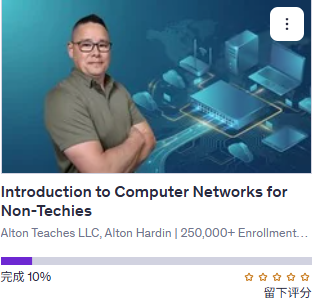

# Course Name
[Introduction to Computer Networks for Non-Techies](https://www.udemy.com/course/introduction-to-computer-networks/?couponCode=CP261123G1) 

# Instructor Introduction
	Alton Hardin 
	IT network management master 
	Over 20 years 
	Department of Treasury in the United States, 网络安全专家 for 12 years 
	Roles 
		• helpdesk support 
		• desktop support 
		• network support 
		• database administration 
		• web app development 
		• systems administration 
		• cyber security 
	兼职大学教授：教授当地本科生的 computer networking 课程 
	已在 Udemy 教授 for 7 years, 收获了 100,000 students 
	
# Screenshots

